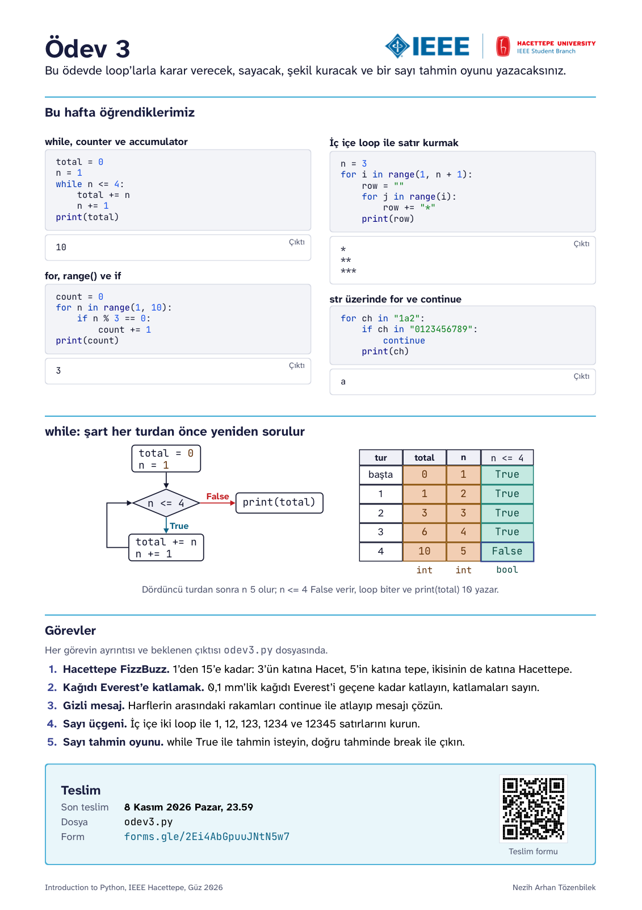
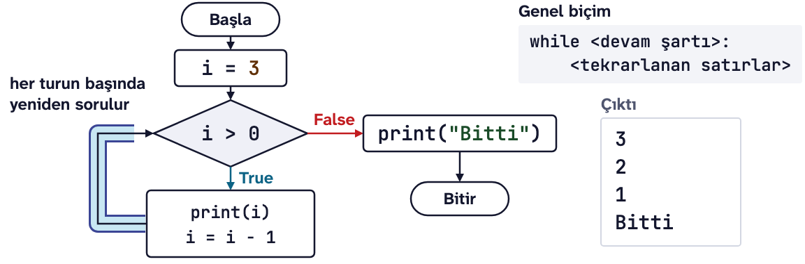
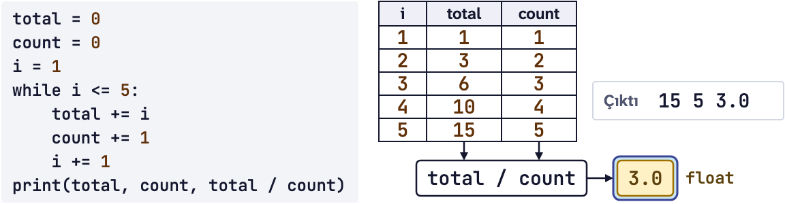
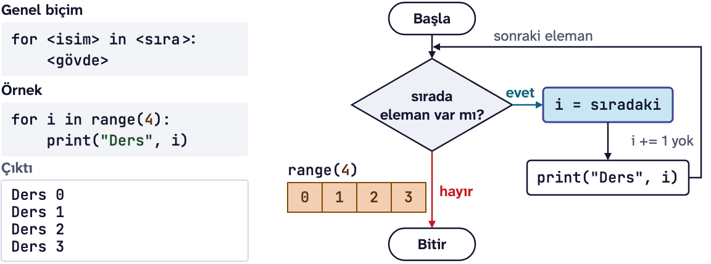
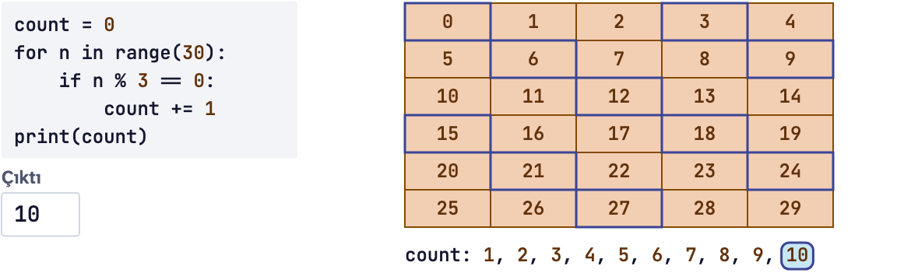
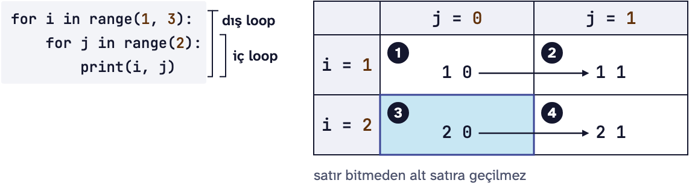
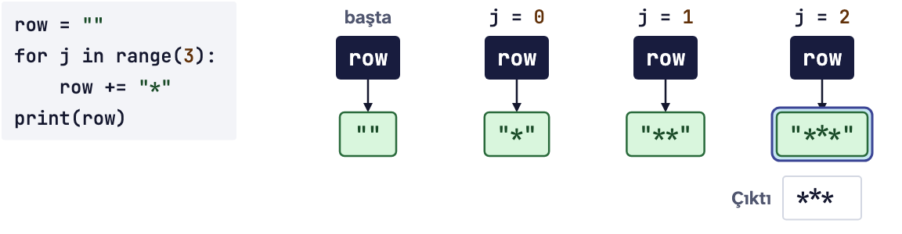
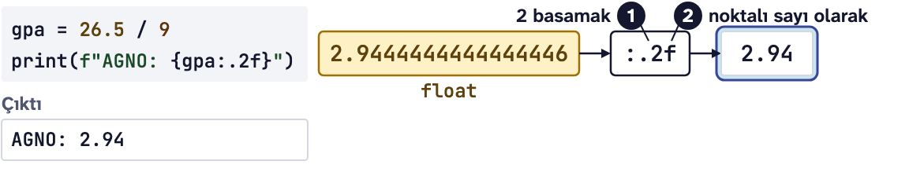

# Ödev 3: Kağıdı Everest'e katlamak

IEEE Hacettepe **Introduction to Python** dersinin 3. ödevi, Güz 2026.

<p align="center"></p>

Yukarıdaki kart bu haftanın özeti. Aşağıda aynı konuların daha ayrıntılı tekrarı var.

**İndirmek için:** yeşil **Code** düğmesine basın, **Download ZIP** deyin, zip'i açın. Git bilmenize gerek yok.

**Son teslim:** 8 Kasım 2026 Pazar, 23.59\
**Teslim:** [Ödev 3 teslim formu](https://forms.gle/2Ei4AbGpuuJNtN5w7)

Bu ödevin sonunda if, elif ve else ile karar veren, while ve for loop'larıyla (döngüler) sayan ve toplayan, bir str'yi (karakter dizisi) harf harf dolaşan, nested loops (iç içe döngüler) ile satır satır şekil kuran ve break ile loop'tan çıkan programlar yazabileceksiniz.

## Bu ödevde kullanacaklarımız

Hepsini Ders 3'te gördük. Görevlerde gereken birkaç Ders 2 konusunu da en sona ekledim.

### if, else ve elif
if bir şart sorar ve iki noktayla biter; altındaki girintili satırlar onun block'udur. Şart True ise block çalışır, False ise atlanır. else'in kendi şartı yoktur: if ile aynı hizada yazılır ve şart False olunca çalışır.

```python
score = 40
if score >= 50:
    print("geçti")
else:
    print("kaldı")
print("bitti")
```

```text
kaldı
bitti
```

`bitti` block'un dışında olduğu için şart ne olursa olsun yazılır.

elif, "else if" demektir: yalnızca üstündeki şartlar False ise sorulur. Şartlar yukarıdan aşağı sınanır; ilk True olanın block'u çalışır, gerisine bakılmaz bile. Bu yüzden sıra önemlidir:

```python
score = 95
if score >= 50:
    print("Geçti")
elif score >= 90:
    print("Yüksek onur")
```

```text
Geçti
```

95, 90'dan da büyük ama ilk True `score >= 50` olduğu için ikinci şart hiç sınanmadı. Daha dar olan `score >= 90` şartını üste yazınca çıktı `Yüksek onur` olur.

Ayrı iki if ise iki ayrı sorudur, ikisi de sorulur:

```python
score = 90
if score >= 85:
    print("A3 ve üstü")
if score >= 50:
    print("geçti")
```

```text
A3 ve üstü
geçti
```

Aynı soruya tek cevap istiyorsanız elif, birbirinden bağımsız sorular için ayrı if yazın.

**Sık yapılan hata:** if satırından sonraki satırı girintisiz yazmak:

```text
IndentationError: expected an indented block after 'if' statement on line 2
```

### while loop
`while`, devam şartı True olduğu sürece altındaki block'u (blok) tekrar tekrar çalıştırır. Şart her turun başında yeniden sorulur. False olduğunda loop biter ve program loop'tan sonraki satırdan devam eder.

```text
while <devam şartı>:
    <tekrarlanan satırlar>
```



```python
i = 10
while i > 0:
    print(i)
    i = i - 3
print("Bitti")
```

```text
10
7
4
1
Bitti
```

Her while üç parçayla çalışır:

| Parça | Örnekte | Ne yapar |
|---|---|---|
| Başlangıç | `i = 10` | Loop başlamadan variable'a (değişken) ilk value'sunu (değer) verir |
| Devam şartı | `i > 0` | Her turun başında sorulur; True ise bir tur daha dönülür |
| Güncelleme | `i = i - 3` | Variable'ı değiştirir ve şartı eninde sonunda False yapar |

`if` de bir şart sorar ama yalnızca bir kez; `while` her turun başında yeniden sorar.

**Sık yapılan hata:** güncellemeyi unutmak. `i` hiç değişmezse şart hep True kalır ve loop bitmez. Buna infinite loop (sonsuz döngü) denir. Python hata vermez, aynı satırı durmadan yazar. Programı PyCharm'da Run penceresindeki kırmızı kare, **Stop** düğmesi durdurur.

### Counter (sayaç), accumulator ve +=
Counter her turda bir artar ve turları sayar. Accumulator ise loop boyunca bir toplamı biriktirir. İkisi de loop'tan önce 0'dan başlar.



`x += 1`, `x = x + 1`'in kısa yazılışıdır. str'de de çalışır:

| Yazılış | Uzun hali | Önce | Sonra |
|---|---|---|---|
| `x += 1` | `x = x + 1` | `5` | `6` |
| `total += 2.5` | `total = total + 2.5` | `0` | `2.5` |
| `word += "tepe"` | `word = word + "tepe"` | `"Bey"` | `"Beytepe"` |

Python'da `x++` yoktur; yazarsanız `SyntaxError: invalid syntax` alırsınız.

2'den 10'a kadar çift sayıları bir counter ile sayan ve bir accumulator ile toplayan loop:

```python
count = 0
total = 0
i = 2
while i <= 10:
    count += 1
    total += i
    i += 2
print(count, total, total / count)
```

```text
5 30 6.0
```

Son sayı ortalama: counter ile accumulator birlikte ortalamayı verir.

**Sık yapılan hata:** `total = 0`'ı loop'un içine yazmak. Toplam her turda sıfırlanır ve sonda yalnızca son tur kalır, tıpkı her üründen sonra toplamı sıfırlayan bir kasiyer gibi. Aşağıdaki kod 1 + 2 + 3 = 6 yerine 3 yazar:

```python
i = 1
while i <= 3:
    total = 0
    total += i
    i += 1
print(total)
```

```text
3
```

### for loop ve range()
`for`, bir sıranın elemanlarını sırayla tek tek alır. Şimdilik sıramız `range()`. Her turda sıradaki sayı `for`'dan sonraki isme atanır ve onu `for` kendisi ilerletir; `i += 1` yazmazsınız.

```text
for <isim> in <sıra>:
    <gövde>
```



```python
for week in range(1, 4):
    print(f"{week}. hafta")
```

```text
1. hafta
2. hafta
3. hafta
```

`range()` tam sayılar üretir. Bitiş hiçbir zaman dahil değildir:

| Yazılış | Verdiği sayılar | Not |
|---|---|---|
| `range(5)` | 0, 1, 2, 3, 4 | Tek sayı verilirse başla 0'dır |
| `range(1, 6)` | 1, 2, 3, 4, 5 | Bitiş, istediğiniz son sayının bir fazlası |
| `range(0, 10, 3)` | 0, 3, 6, 9 | Üçüncü sayı adımdır |
| `range(10, 0, -3)` | 10, 7, 4, 1 | Negatif adım geriye sayar |
| `range(10, 0)` | hiç sayı yok | Adım yazılmazsa +1'dir; 10'dan 0'a artarak varılmaz |

Kaç tur döneceği belliyse `for`, belli değilse `while` kullanın.

**Sık yapılan hata:** bitişi bir eksik yazmak. 1'den 10'a kadar saymak için `range(1, 11)` gerekir; `range(1, 10)` 9'da durur. `for i in 10:` gibi range olmadan bir sayı yazarsanız da `TypeError: 'int' object is not iterable` alırsınız.

### for içinde if, elif ve else
if, elif ve else loop'un gövdesinde de çalışır ve her turda yeniden sorulur. Bir sayının başka bir sayının katı olup olmadığını `%` operator'ı (işlemci) söyler: kalan 0 ise kattır.



```python
for n in range(1, 5):
    if n % 2 == 0:
        print(n, "çift")
    else:
        print(n, "tek")
```

```text
1 tek
2 çift
3 tek
4 çift
```

### Nested loops (iç içe döngüler)
Bir loop'un gövdesinde başka bir loop olabilir. İç loop, dış loop'un her turunda baştan sona çalışır. Her katta o katın bütün kapılarına ekmek bırakan kapıcıyı düşünün: katlar dış loop, kapılar iç loop.



```python
for floor in range(1, 3):
    for door in range(1, 4):
        print(floor, door)
```

```text
1 1
1 2
1 3
2 1
2 2
2 3
```

Dış loop 2, iç loop 3 tur döndüğü için iç gövde 2 × 3 = 6 kez çalıştı.

### Satır satır şekil kurmak
Ekrana bir şekli satır satır çizmek için her satırı önce bir str'de kurar, sonra tek bir `print()` ile yazarız. `row` boş str'den (`""`) başlar ve her turda `+=` ile büyür. Aşağıdaki dama tahtasında dolu kareler `#`, boş kareler `.`:

```python
for i in range(4):
    row = ""
    for j in range(6):
        if (i + j) % 2 == 0:
            row += "#"
        else:
            row += "."
    print(row)
```

```text
#.#.#.
.#.#.#
#.#.#.
.#.#.#
```



İki satırın yeri önemli: `row = ""` dış loop'un içinde, her satırın başında duruyor; `print(row)` ise iç loop bittikten sonra, yine dış loop'un içinde.

| Yanlış yer | Ne olur |
|---|---|
| `row = ""` dış loop'tan önce | `row` hiç boşalmaz, her satır bir öncekinin devamı olarak uzar |
| `print(row)` iç loop'un içinde | Satır her eklemeden sonra yeniden yazılır, yarım satırlar da çıkar |

İkisinde de Python hata vermez, yalnızca çıktı yanlış olur. Böyle bir durumda satırların indentation'ına (girinti) bakın.

Bir str'ye sayı eklemek için sayıyı önce `str()` ile str'ye çevirin, çünkü `+` bir str ile bir int'i birleştiremez:

```python
label = "Ders "
label += str(3)
print(label)
```

```text
Ders 3
```

`label += 3` yazarsanız şu error message'ı (hata mesajı) alırsınız:

```text
TypeError: can only concatenate str (not "int") to str
```

### str üzerinde for
str de bir sıradır: for onun karakterlerini sırayla tek tek alır. Her turda `ch` bir sonraki karakteri gösterir; adını siz koyarsınız.

```python
code = "MAT101"
for ch in code:
    print(ch)
```

```text
M
A
T
1
0
1
```

Bir counter ile, örneğin bir harfin kaç kez geçtiğini sayabilirsiniz:

```python
count = 0
for ch in "Hacettepe":
    if ch == "e":
        count += 1
print(count)
```

```text
3
```

Bir karakterin rakam olup olmadığını Ders 2'deki `in` söyler: `ch in "0123456789"` True ise `ch` bir rakamdır.

### while True ve break
`break`, içinde bulunduğu loop'u hemen bitirir; akış loop'tan sonraki satırdan devam eder. `while True`'nun şartı hiç False olmaz, böyle bir loop'tan ancak break ile çıkılır. Kullanıcı bir bitiş işareti ya da doğru cevabı yazana kadar sormak için kullanılır:

```python
total = 0
while True:
    score = int(input("Puan (bitirmek için 0): "))
    if score == 0:
        break
    total += score
print("Toplam:", total)
```

```text
Puan (bitirmek için 0): 70
Puan (bitirmek için 0): 90
Puan (bitirmek için 0): 0
Toplam: 160
```

Buradaki 0 bir sentinel'dir (bitiş işareti): kendisi toplanmaz, yalnızca loop'u bitirir.

**Sık yapılan hata:** break'i bir loop'un dışına yazmak. Python dosyanın hiçbir satırını çalıştırmaz:

```text
SyntaxError: 'break' outside loop
```

### continue
`continue` loop'u bitirmez, yalnızca o turu bitirir: akış loop'un başına döner ve loop sıradaki turla devam eder.

```python
for i in range(1, 6):
    if i % 2 == 0:
        continue
    print(i)
```

```text
1
3
5
```

break ile karıştırmayın: break loop'u bitirir, continue yalnızca o turu. Bu kodda continue yerine break yazsaydık çıktı yalnızca `1` olurdu.

**Sık yapılan hata:** while loop'unda continue'yu sayacı artıran satırdan önce yazmak. O turda sayaç artmaz, şart hep True kalır ve loop hiç bitmez.

### Ders 2'den: f-string, :.2f ve input()
f-string'de `{}` içine yazılan expression'ın (ifade) value'su yazının içine yerleşir. `:.2f` value'yu noktadan sonra iki basamakla gösterir; variable'ın kendisi değişmez.



```python
price = 100 / 3
print(f"Kişi başı: {price:.2f} TL")
print(price)
```

```text
Kişi başı: 33.33 TL
33.333333333333336
```

`input()` kullanıcının yazdığını her zaman str olarak verir. Sayı olarak kullanmak için `int()` ile çevirin:

```python
year = int(input("Yıl: "))
print(year + 1)
```

```text
Yıl: 2026
2027
```

## Görevler

Görevlerin ayrıntısı ve her birinin beklenen çıktısı `odev3.py` dosyasının içinde.

1. **Hacettepe FizzBuzz:** for ve range() ile 1'den 15'e kadar her sayı için 3'ün katına Hacet, 5'in katına tepe, ikisinin de katına Hacettepe yazdıracaksınız. if, elif ve else'i hangi sırayla yazdığınız önemli.
2. **Kağıdı Everest'e katlamak:** 0,1 mm'lik bir kağıdı kalınlığı Everest'i geçene kadar while ile katlayacak, katlamaları sayacak ve kalınlığı metre olarak yazdıracaksınız.
3. **Gizli mesaj:** Harflerin arasına saklanmış rakamları for ve continue ile atlayıp mesajı çözecek, atlanan rakamları da sayacaksınız.
4. **Sayı üçgeni:** İç içe iki loop ile 1, 12, 123, 1234 ve 12345 satırlarını kuracaksınız.
5. **Sayı tahmin oyunu:** while True ile tahmin isteyecek, "Daha büyük." ya da "Daha küçük." diye ipucu verecek, doğru tahminde break ile çıkıp kaç denemede bilindiğini yazdıracaksınız.

Zorunlu olmayan bir **Meraklısına** görevi de var: 2026'nın basamaklarını while ile sayacak, toplayacak ve sayıyı ters çevireceksiniz.

Yalnızca Ders 1, 2 ve 3'te gördüğümüz yapıları kullanın.

## Nasıl çalışılır

1. Zip'ten çıkan `odev3.py` ve `kontrol.py` dosyalarını aynı klasörde tutun ve `odev3.py`'yi PyCharm'da açın.
2. Her görevde `# TODO` satırının yerine kodunuzu yazın.
3. Dosyayı **Run** ile çalıştırın ve çıktıyı görevin "Beklenen çıktı" kısmıyla karşılaştırın.

5. görevde program sizden tahmin ister: Run penceresine sırayla 50, 25 ve 37 yazın, her birinden sonra Enter'a basın.

## Kendi kendinize kontrol

Bitirince `kontrol.py`'yi PyCharm'da açıp **Run** deyin. Her görev için geçti ya da kaldı yazar, kaldıysa beklenen satırı ve sizin satırınızı gösterir. Görevin istediği yapıyı, örneğin while'ı, continue'yu ya da break'i kullanıp kullanmadığınıza da bakar. 3, 4 ve 5. görevlerde baştaki value'yu değiştirip dosyayı bir kez daha çalıştırır; sonucu elle yazdıysanız bunu fark eder. 5. görevin sorularına 50, 25 ve 37'yi kendisi yazar. Dosya 10 saniyede bitmezse durdurur ve hangi görevde takıldığını söyler. Kontrol not vermez, sadece size yol gösterir.

## Teslim

[Ödev 3 teslim formunda](https://forms.gle/2Ei4AbGpuuJNtN5w7) "İsim" alanına isminizi yazın, `odev3.py`'yi "Ödev dosyası" alanına yükleyin ve "Kişisel verileriniz" sorusundaki onay kutusunu işaretleyin. Söylemek istediğiniz bir şey varsa isteğe bağlı "Açıklama" alanına yazabilirsiniz.

Takıldığınız bir yer olursa dersin WhatsApp grubuna yazın.

Dersin sitesi: https://natozenbilek.github.io/ieee-hacettepe-python-course/
